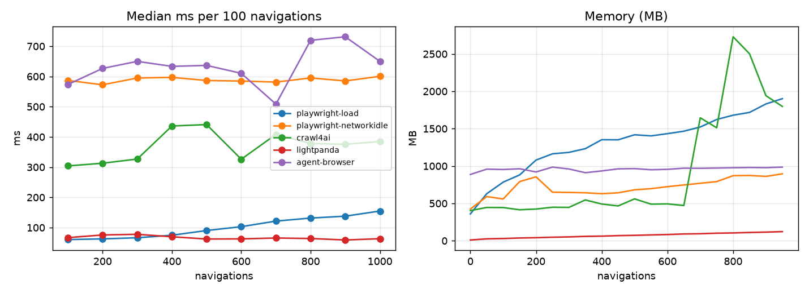

# agent-browser-bench

**What do browsers built for AI agents actually return, how fast, and do they hold up after
1,000 pages?**

Agents read the web through a browser layer: Playwright directly, a crawler like Crawl4AI,
an agent-first CLI like agent-browser, or a new engine like Lightpanda. This benchmark runs
each one on the same local test site, through its own default "open the page and give me
the text" path, and checks one thing per page: **did the text the tool returned contain
the page's content?** Then it runs 1,000 navigations in a row on one browser to see whether
it slows down or grows.

Everything runs against a local site (`site/server.py`), so no real website is hit and every
run is reproducible.

## The test site

| kind | what it is | why it's there |
|---|---|---|
| `static` | ~40 KB server-rendered article | the easy case |
| `spa` | an empty shell; JS fills the content 300 ms after `load` | how most apps render |
| `heavy` | ~6,000 DOM nodes, 30 images | big pages |
| `slow` | the server waits 1.5 s before answering | slow backends |
| `state` | writes ~512 KB to localStorage and sets cookies on every visit | state that piles up in a long-lived browser |

Each page carries a unique token (`TOKEN-<kind>-<i>`). A navigation only counts as a
success if that token is in the returned text, so a "Loading..." shell counts as a miss.

## Tools (versions as tested, 2026-11-15)

| name here | what runs | how a page is read |
|---|---|---|
| `playwright-load` | Playwright 1.65.2, Chromium headless shell, one tab reused | `goto(wait_until="load")` then `inner_text("body")` |
| `playwright-networkidle` | same, waiting for network idle | `goto(wait_until="networkidle")` then `inner_text("body")` |
| `crawl4ai` | Crawl4AI 0.9.5, defaults, cache bypassed | `arun(url)` → markdown |
| `lightpanda` | Lightpanda 1.0.4 in Docker, driven over CDP by Playwright | `goto(wait_until="load")` then `inner_text("body")` |
| `agent-browser` | agent-browser 0.43.0 CLI (it launched the installed Chrome 157, headless, temp profile) | `agent-browser open <url>` then `agent-browser get text body` |

The harness adds no waits of its own. A miss on `spa` is the tool's default behaviour, not
a harness bug, and every tool can be told to wait (see below).

**Not included: browser-use.** browser-use 1.0 drives Chrome through an LLM agent; it has no
plain "open this URL and return the text" call to time without a model in the loop, and its
browser is stock Chrome over CDP, which `playwright-*` already covers.

## Results

Windows 11, 16 threads, 24 GB RAM, nothing else running. Two independent runs of the page
suite gave the same picture; the table is the second (`results/run3`), the first is in
`results/run2`.

### Pages (30 of each kind per tool)

Cell = pages where the content came back / pages · median / p95 ms.

| tool | startup ms | static | spa | heavy | slow | state |
|---|---|---|---|---|---|---|
| playwright-load | 1105 | 30/30 · 49 / 63 | **0/30** · 47 / 60 | 30/30 · 130 / 173 | 30/30 · 1586 / 1624 | 30/30 · 46 / 57 |
| playwright-networkidle | 709 | 30/30 · 550 / 561 | 30/30 · 551 / 562 | 30/30 · 628 / 671 | 30/30 · 2090 / 2114 | 30/30 · 549 / 558 |
| crawl4ai | 3226 | 30/30 · 322 / 373 | **0/30** · 284 / 323 | 30/30 · 641 / 756 | 30/30 · 1791 / 1824 | 30/30 · 334 / 361 |
| lightpanda | 1804 | 30/30 · 56 / 73 | **0/30** · 49 / 64 | 30/30 · 98 / 122 | 30/30 · 1552 / 1563 | 30/30 · 52 / 65 |
| agent-browser | 9423 | 30/30 · 516 / 621 | **5/30** · 523 / 599 | 30/30 · 618 / 865 | 30/30 · 2025 / 2162 | 30/30 · 522 / 637 |

Why the `spa` misses happened:

- `playwright-load`, `lightpanda`: the text was read at `load`, before the content arrived ("Loading..." came back).
- `agent-browser`: `open` returns before the content arrives most of the time (5/30 and 7/30 in two runs).
- `crawl4ai`: the crawl fails with `success=False`, `Blocked by anti-bot protection: Structural: minimal_text on small page`.
  Nothing is blocking it: the same page succeeds with `wait_for="css:#t"`. Reported upstream with a repro:
  [unclecode/crawl4ai#2058 (comment)](https://github.com/unclecode/crawl4ai/issues/2058).

### Endurance (1,000 navigations in a row, one browser, static/spa/heavy/state cycling)

| tool | content returned | median ms, first 100 → last 100 | static pages only, first 25 → last 25 | memory MB, start → end |
|---|---|---|---|---|
| playwright-load (one tab reused) | 750/1000 | 60 → 155 | **49 → 141** | **359 → 1,971** |
| playwright-networkidle (one tab reused) | 1000/1000 | 587 → 600 | 566 → 583 | 424 → 898 |
| crawl4ai (new page per crawl) | 750/1000 | 304 → 385 | 301 → 359 | 404 → 3,786 (one-off, see below) |
| lightpanda | 750/1000 | 67 → 63 | 68 → 63 | 10 → 126 (container) |
| agent-browser | 896/1000 | 574 → 650 | 541 → 635 | 887 → 985 |

The 750/1000 rows are the `spa` pages (a quarter of the mix) missed for the reason above.

**Crawl4AI's memory spike did not reproduce.** In this run its process tree jumped after
~700 pages; in the first run (480 → 517 MB) and in a third run with a per-process breakdown
(`bench/probe_crawl4ai.py`: 194 → 283 MB private memory, 6 processes throughout, ~300 ms per
page from start to end) it stayed flat. Treat it as unexplained, not as a finding.



### The long-lived tab, isolated (`bench/probe_growth.py`)

1,000 navigations of the plain `static` page in one Chromium tab, renderer memory and median
ms per 100 pages, first → last:

| setup | median ms | renderer MB |
|---|---|---|
| one tab, `load`, back-to-back | 56 → 144 | 406 → 1,131 |
| same, back/forward cache disabled | 42 → 122 | 415 → 1,247 |
| same, forced JS GC after every page | 49 → 160 | 191 → 545 |
| one tab, `load`, 500 ms pause between pages | 47 → 86 | 139 → 253 |
| one tab, `networkidle` | 563 → 571 | 176 → 271 |
| a new tab for every page | 61 → 85 | 78 → 235 |

## What this shows

1. **By default, almost nothing waits for content that renders after `load`.** Content that
   arrives 300 ms after the load event was missed by four of the five setups: 0/30 for
   Playwright at `load`, Lightpanda and Crawl4AI, 5–7/30 for agent-browser. Only Playwright's
   `networkidle` got all of it, at ~550 ms a page instead of ~50. An agent reading "Loading..."
   does not know it missed anything.
2. **Crawl4AI reports that case as an anti-bot block.** The page is fine and `wait_for` fixes
   it, but the default error points at proxies and stealth settings.
3. **Lightpanda is the fastest and lightest here**: ~56 ms per static page, ~98 ms for the
   heavy one (Chromium: ~130), and 10 → 126 MB over 1,000 pages against 360 MB+ for any
   Chromium setup. It needs the same explicit wait as Chromium for late content.
4. **A Chromium tab driven back-to-back slows down and grows.** One reused tab at `load`
   went from ~50 to ~140 ms per page and its renderer to 1–2 GB over 1,000 pages. A new tab
   per page, or 500 ms of idle between pages, keeps it flat. It is not the back/forward cache;
   forcing JS garbage collection halves the memory but not the slowdown, so the cause is not
   pinned down here. For an agent or crawler that reuses one tab at full speed, the practical
   fix is to recycle the tab every few hundred pages.
5. **Startup cost differs by 10×**: ~1 s for Playwright, ~2–3 s for Lightpanda (container),
   ~3–5 s for Crawl4AI, ~9–10 s for agent-browser's first command (daemon plus Chrome).
   agent-browser's ~520 ms per page is mostly the two CLI calls it takes: a command that does
   not navigate (`get title`) costs ~180 ms on its own, and `open` of a static page ~264 ms
   (15 calls each, medians).

## Run it

```bash
python -m venv .venv && .venv/Scripts/pip install -r requirements.txt   # bin/ on Linux/macOS
.venv/Scripts/python -m playwright install chromium
npm i --prefix tools                                                     # agent-browser
docker pull lightpanda/browser:1.0.4

python site/server.py 8765 &          # Lightpanda reaches it at host.docker.internal
python -m bench.run pages --tools all --n 30
python -m bench.run endurance --tools all --n 1000
python -m bench.report results
python -m bench.probe_growth --kind static --n 1000        # the long-lived-tab probe
```

Raw rows are in `results/<run>/*.jsonl`, one line per navigation.

## Limits

- One machine, Windows. Absolute times will differ elsewhere; compare tools, not numbers.
- agent-browser ran the installed Chrome 157; the Playwright-based tools ran Playwright's
  Chromium headless shell. Part of any gap between them may be the browser build.
- agent-browser's time includes starting a CLI process per command, which is what an agent
  using the CLI pays. Its daemon could be driven more directly; that was not tested.
- Lightpanda's memory is the container's, the others' is their process tree's RSS.
- Local pages only: no network latency, TLS, bot checks or third-party scripts.
- A first full run was discarded: other heavy work ran on the machine at the same time and
  Lightpanda's static median came out at ~300 ms against ~56 ms idle. Every number above is
  from runs with nothing else running.

## License

MIT
