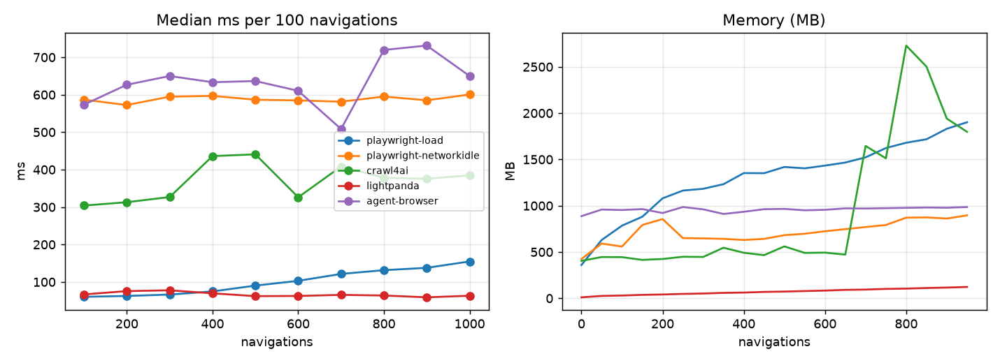

# Results: run2

Platform: Windows-11-10.0.26300-SP0, Python 3.13.1.

## Pages: did the tool return the page's content, and how fast

Success = the page's unique token was in the text the tool returned. Times are median / p95 in ms, successful and failed navigations together.

| tool | startup ms | static | spa | heavy | slow | state |
|---|---|---|---|---|---|---|
| playwright-load | 4891 | 30/30 · 92 / 175 | 0/30 · 85 / 158 | 30/30 · 250 / 335 | 30/30 · 1692 / 1934 | 30/30 · 84 / 216 |
| playwright-networkidle | 1093 | 30/30 · 578 / 611 | 30/30 · 574 / 612 | 30/30 · 727 / 4955 | 30/30 · 2140 / 2233 | 30/30 · 572 / 2001 |
| crawl4ai | 5239 | 30/30 · 396 / 462 | 0/30 · 347 / 376 | 30/30 · 835 / 907 | 30/30 · 1860 / 4921 | 30/30 · 415 / 462 |
| lightpanda | 2730 | 30/30 · 64 / 90 | 0/30 · 56 / 72 | 30/30 · 105 / 151 | 30/30 · 1554 / 1579 | 30/30 · 55 / 74 |
| agent-browser | 10201 | 30/30 · 544 / 704 | 7/30 · 528 / 646 | 30/30 · 636 / 796 | 30/30 · 2052 / 2164 | 30/30 · 535 / 669 |

### Failure reasons

- **playwright-load**: spa: `token missing` ×30
- **crawl4ai**: spa: `RuntimeError: Blocked by anti-bot protection: Structural: minimal_text on small page` ×30
- **lightpanda**: spa: `token missing` ×30
- **agent-browser**: spa: `token missing` ×23

## Endurance: one browser, many navigations in a row

Median ms per window of 100 navigations (static/spa/heavy/state, cycling). Memory is the tool's process tree (or container) RSS.

| tool | success | first 100 median ms | last 100 median ms | static pages, first 25 → last 25 median ms | memory MB, start → end |
|---|---|---|---|---|---|
| playwright-load | 750/1000 | 60 | 155 | 49 → 141 | 359 → 1971 |
| playwright-networkidle | 1000/1000 | 587 | 600 | 566 → 583 | 424 → 898 |
| crawl4ai | 750/1000 | 304 | 385 | 301 → 359 | 404 → 3786 |
| lightpanda | 750/1000 | 67 | 63 | 68 → 63 | 10 → 126 |
| agent-browser | 896/1000 | 574 | 650 | 541 → 635 | 887 → 985 |

